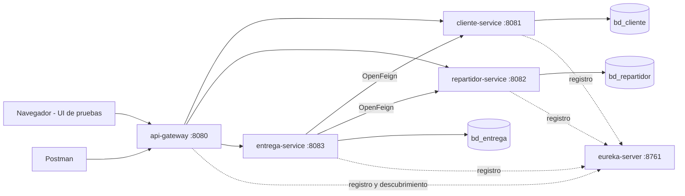

# Arquitectura

## Principios

- Responsabilidad unica por servicio.
- Database-per-Service: cada servicio tiene su base y no hay claves foraneas entre bases.
- Comunicacion sincrona REST solo de entrega-service hacia cliente-service y repartidor-service.
- Todo acceso externo pasa por el gateway.

## Componentes

**eureka-server (8761).** Registro de servicios. Cada servicio se registra al arrancar y los demas lo encuentran por nombre, sin direcciones fijas.

**api-gateway (8080).** Unico punto de entrada. Tiene tres rutas explicitas hacia `lb://cliente-service`, `lb://repartidor-service` y `lb://entrega-service`, resueltas con Eureka. Aplica CORS global y un filtro que registra metodo, ruta, estado y duracion de cada peticion. Sirve ademas la UI estatica en `/`.

**cliente-service (8081).** CRUD de clientes sobre `bd_cliente`. El email es unico (409 si se repite). Validacion de datos con `jakarta.validation`.

**repartidor-service (8082).** CRUD de repartidores sobre `bd_repartidor`, con tipo de vehiculo (MOTO, BICICLETA, AUTO) y un indicador `activo` que se cambia con PATCH.

**entrega-service (8083).** Registra entregas sobre `bd_entrega`. Antes de guardar consulta con OpenFeign que existan el cliente y el repartidor y que el repartidor este activo. La fecha y el estado inicial (PENDIENTE) los asigna el servicio. Las transiciones de estado solo avanzan: PENDIENTE a EN_CAMINO y EN_CAMINO a ENTREGADA. Si un servicio dependiente no responde, devuelve 503.

**Capas de cada servicio de dominio.** `controller` (REST), `service` (interfaz e implementacion, mapeo manual entidad-DTO), `repository` (Spring Data JPA), `model` (entidades y enums), `dto` (records), `exception` (excepciones propias y `@RestControllerAdvice`), `config` (OpenAPI).

## Manejo de errores

Cada servicio de dominio responde los errores con el mismo JSON (`timestamp`, `status`, `error`, `message`, `path` y, solo en validaciones, `errors`). Un error no previsto responde 500 con mensaje generico, sin stacktrace ni detalles de infraestructura.
